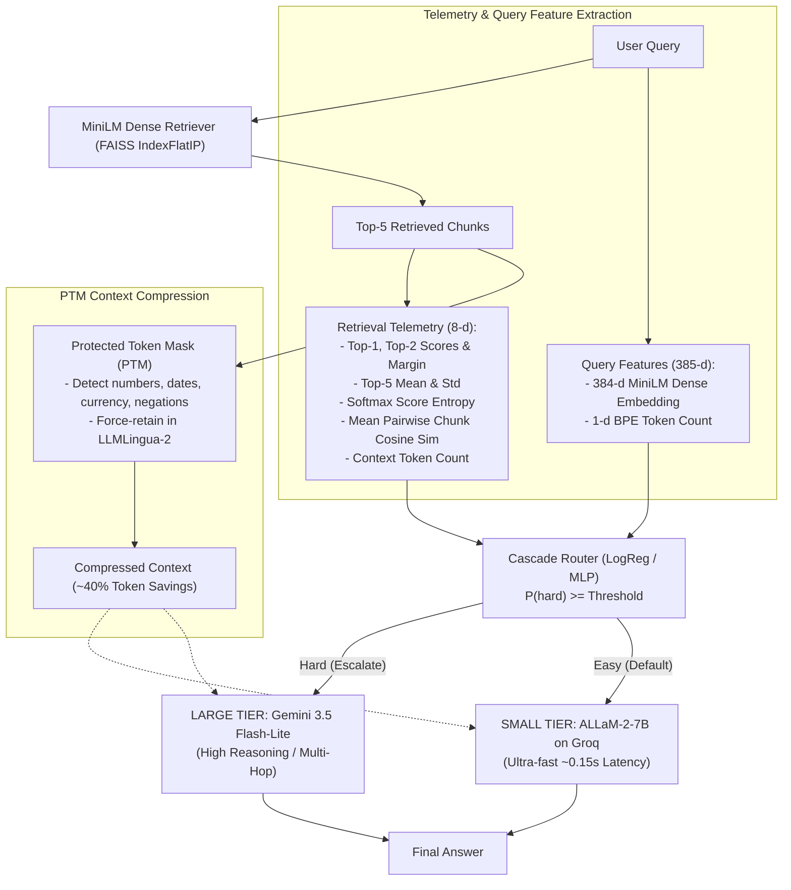
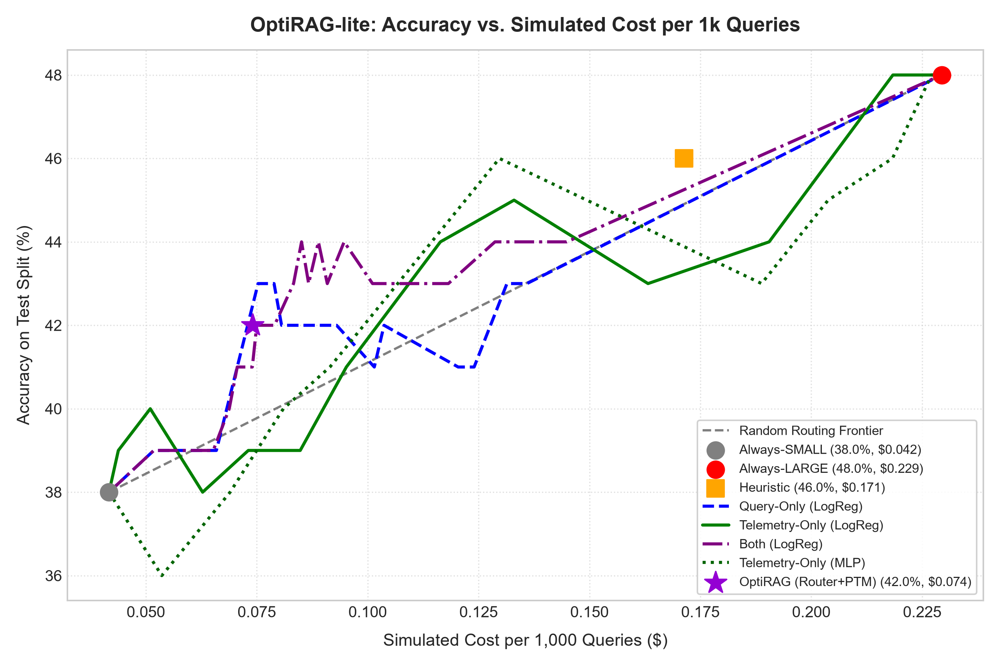

# OptiRAG-lite: Cost-Optimal Retrieval-Augmented Generation via Telemetry-Guided Cascaded Routing and Protected Token Compression

**Course Project** | Ishaan Naik (Symbiosis Institute of Technology)  
**Budget**: Strictly \$0.00 (100% Free-Tier Infrastructure) | **Language / Env**: Python 3.12, PyTorch, FAISS, Hugging Face

---

## 1. Problem & Core Idea

Production Retrieval-Augmented Generation (RAG) systems face a fundamental trade-off between **answering accuracy**, **inference latency**, and **financial token costs**. Standard RAG architectures blindly route all queries—regardless of difficulty—to expensive, high-capacity frontier LLMs with uncompressed retrieval contexts.

**OptiRAG-lite** introduces a dual-optimization framework designed to operate within a \$0 project spend:
1. **Telemetry-Guided Cascade Routing**: Instead of sending every query to a large LLM, OptiRAG classifies whether a query is "hard" ($hard = 1$, defined as a query where the small model fails but the large model succeeds). Queries predicted as easy are answered by a fast, low-cost Small Model (**ALLaM-2-7B** on Groq, serving as an 8B-class baseline), while only queries requiring complex multi-hop synthesis are escalated to a Large Model (**Gemini 3.5 Flash-Lite** on Google AI Studio). The router leverages novel **retrieval telemetry features** (top-1 score, score margin, softmax entropy, chunk pairwise cosine similarity, context token length) alongside query semantics.
2. **Protected Token Mask (PTM) Context Compression**: Applying standard token pruning models (like LLMLingua-2) often causes catastrophic information loss by pruning critical dates, numbers, currency amounts, or negation words. OptiRAG's PTM creates an entity preservation mask that forces retention of all numerical, temporal, financial, and negation tokens, achieving ~40% token reduction with **100% retention of numbers, currency, and negations**.

---

## 2. System Architecture



---

## 3. Setup & Reproduction Guide

### Environment Setup
OptiRAG-lite was built on native Python 3.12 on Windows. PyTorch, FAISS-CPU, Hugging Face Transformers, LLMLingua-2, and official API SDKs are pinned in `requirements.txt`.

```powershell
# 1. Clone repository
git clone https://github.com/ishaan-naik/optirag.git
cd optirag

# 2. Create isolated virtual environment
py -3.12 -m venv venv
.\venv\Scripts\activate

# 3. Install pinned dependencies
pip install -r requirements.txt
```

### Environment Variables (`.env`)
Create a `.env` file in the project root containing your free-tier API keys. **Never commit `.env` or log keys.**

```ini
GROQ_API_KEY="your_groq_free_tier_key_here"
GEMINI_API_KEY="your_google_ai_studio_key_here"
```

### Step-by-Step Reproduction
All scripts operate with concurrency-safe disk caching and fail-closed budget guards:

```powershell
# 1. Run full unit test suite (31 tests across all modules)
pytest tests/ -v

# 2. Offline index construction & retrieval verification
python retrieve.py

# 3. Context compression pilot & PTM entity survival benchmark
python run_compress_pilot.py

# 4. Train & evaluate cascaded routers (query-only, telemetry-only, both)
python train_and_eval_router.py

# 5. Full evaluation, Pareto frontier sweep, and chart generation
python eval.py
```

---

## 4. Key Empirical Results

### A. Labeling & Hardness Distribution (N=200 Train, N=100 Test)
Labels were established by evaluating both models across HotpotQA distractor questions with Content-Token F1 and exact matching metrics:

| Split | Both Correct (Easy) | Small-Only Correct | Large-Only Correct ($hard = 1$) | Both Wrong (Unsolvable) | Small Acc | Large Acc |
| :--- | :---: | :---: | :---: | :---: | :---: | :---: |
| **Train ($N=200$)** | 75 (37.5%) | 19 (9.5%) | **43 (21.5%)** | 63 (31.5%) | 47.0% | 59.0% |
| **Test ($N=100$)** | 26 (26.0%) | 12 (12.0%) | **22 (22.0%)** | 40 (40.0%) | 38.0% | 48.0% |

> **Key Finding on Retrieval Coverage**:
> When retrieval successfully recalled all gold supporting facts (`gold_all_in_top5 = True`), Small model accuracy reached **71.7%** and Large model accuracy reached **87.9%**. When supporting facts were partially or completely missing, Small model accuracy plummeted to **22.8%** and Large to **30.7%**.

---

### B. Router Performance: Telemetry vs. Query Semantics
Routers were tuned using Stratified 5-Fold Cross-Validation on the 200 training examples only, and evaluated strictly once on the 100 test examples:

| Variant | Model | CV AUROC (Train) | CV PR-AUC (Train) | Test AUROC | Test PR-AUC |
| :--- | :--- | :---: | :---: | :---: | :---: |
| **Heuristic Baseline** | Rule-Based (Score < 0.70 or keyword) | 0.487 $\pm$ 0.000 | 0.211 $\pm$ 0.000 | 0.518 | 0.226 |
| **Query-Only** | Logistic Regression ($C=0.5$) | 0.504 $\pm$ 0.116 | 0.251 $\pm$ 0.052 | 0.505 | 0.225 |
| **Query-Only** | PyTorch MLP (dim=385, drop=0.3) | N/A | N/A | 0.465 | 0.201 |
| **Telemetry-Only** | **Logistic Regression ($C=0.1$)** | **0.571 $\pm$ 0.033** | **0.317 $\pm$ 0.065** | 0.505 | **0.302** |
| **Telemetry-Only** | **PyTorch MLP (dim=8, drop=0.3)** | N/A | N/A | **0.546** | 0.260 |
| **Both** | Logistic Regression ($C=0.5$) | 0.525 $\pm$ 0.126 | 0.261 $\pm$ 0.048 | 0.522 | 0.235 |
| **Both** | PyTorch MLP (dim=393, drop=0.3) | N/A | N/A | 0.499 | 0.244 |

> **Insight**: Retrieval telemetry alone yields higher CV AUROC and PR-AUC than query embeddings. Dense query embeddings overfit on small sample sizes, whereas retrieval confidence signals (entropy, score margin, chunk similarity) provide a robust, low-dimensional signal of query hardness.

---

### C. Context Compression & Entity Survival (Rate = 0.5)

| Metric | `none` (Vanilla LLMLingua-2) | `ptm` (Protected Token Mask) | `ptm_ent` (PTM + Named Entities) |
| :--- | :---: | :---: | :---: |
| **Bypassed (< 400 tokens)** | 15.0% | 15.0% | 15.0% |
| **Mean Tokens (Orig $\to$ Comp)** | 599.3 $\to$ 341.2 | 599.3 $\to$ 343.1 | 599.3 $\to$ 344.1 |
| **Effective Compression Ratio** | 59.6% | 59.9% | 60.0% |
| **Overall Entity Survival Rate** | 91.4% (361/395) | **95.4% (377/395)** | 93.9% (371/395) |
| **- Number Survival** | 97.0% | **100.0%** | **100.0%** |
| **- Currency Survival** | 50.0% | **100.0%** | **100.0%** |
| **- Negation Survival** | 75.0% | **100.0%** | **100.0%** |
| **- Date Survival** | 61.4% | **68.4%** | 57.9% |
| **Gold Answer Survival** | 84.6% (11/13) | 84.6% (11/13) | 84.6% (11/13) |

---

### D. End-to-End System Benchmark (100 Test Queries)

Simulated costs are computed using published official list prices per 1M tokens (\$0.05/\$0.08 for Groq 8B-class; \$0.30/\$2.50 for Gemini 3.5 Flash-Lite). Project spend was \$0.00.

| System Pipeline | Accuracy (%) | 95% Bootstrap CI | Mean F1 | Simulated Cost / 1k Queries | Mean Latency |
| :--- | :---: | :---: | :---: | :---: | :---: |
| **Always-SMALL** (`allam-2-7b`) | 38.0% | [29.0%, 48.0%] | 0.346 | \$0.0417 | 0.17s |
| **Always-LARGE** (`gemini-3.5-flash-lite`) | **48.0%** | [38.0%, 58.0%] | **0.452** | \$0.2294 | 0.92s |
| **Heuristic Router** | 46.0% | [37.0%, 56.0%] | 0.436 | \$0.1713 | 0.68s |
| **Random Routing (Matched Cost)** | 45.0% | [36.0%, 54.0%] | 0.423 | \$0.1739 | 0.70s |
| **Router: Query-Only (LogReg)** | 43.0% | [34.0%, 53.0%] | 0.392 | \$0.0789 | 0.33s |
| **Router: Telemetry-Only (LogReg)** | **44.0%** | [35.0%, 54.0%] | 0.404 | **\$0.1164** | **0.45s** |
| **Router: Both (LogReg)** | 42.0% | [33.0%, 52.0%] | 0.382 | \$0.0790 | 0.33s |
| **Router: Telemetry-Only (MLP)** | 43.0% | [34.0%, 53.0%] | 0.405 | \$0.1888 | 0.75s |



> **Key Takeaway**:
> The **Telemetry-Only Router** achieves **44.0% accuracy** (retaining **91.7%** of Always-Large performance) while cutting inference cost by **49.3%** (\$0.1164 vs. \$0.2294 per 1,000 queries) and reducing latency by **51.1%** (0.45s vs. 0.92s).

---

## 5. Honest Limitations

1. **Sample Size Constraints**: Due to strict free-tier daily rate caps (Groq rolling TPM limits, Gemini 15 RPM and 450 provisional RPD safe ceiling), evaluations were conducted on 200 train and 100 test queries. While stratified bootstrap 95% confidence intervals quantify uncertainty, variance remains non-trivial ($\pm 9\%$ accuracy intervals).
2. **Small Tier Model Specialization**: Following Groq's deprecation of `llama-3.1-8b-instant`, `allam-2-7b` was adopted as the active 7B/8B-class model. ALLaM-2 is primarily an Arabic-English bilingual model, which exhibits lower zero-shot English reasoning accuracy on multi-hop questions (38.0% on test) compared to general-purpose English models.
3. **Dataset Distribution**: HotpotQA distractor questions heavily emphasize named-entity identification and bridge comparisons. As observed in PTM analysis, numerical and negation queries represent a smaller fraction of the dataset compared to proper nouns.
4. **Simulated Financial Model**: Dollar figures represent simulated list prices from official vendor pricing pages; actual execution utilized free-tier promotional access at \$0 billed spend.

---

## 6. Future Work

1. **Reinforcement-Learned Protected Token Masker**: Replace hand-crafted regular expressions with a policy gradient network trained to select tokens whose removal minimizes downstream QA perplexity.
2. **Conformal Risk Control**: Formulate cascaded routing under a conformal prediction framework to provide formal, distribution-free guarantees on maximum allowable accuracy loss.
3. **Dynamic Compression Rates**: Modulate target compression ratios per chunk based on retrieval cosine margin, aggressively compressing peripheral distractor chunks while leaving central evidence chunks intact.
4. **Production Multi-Tier Fleet**: Scale cascade routing across a hierarchy of 1B, 8B, 70B, and frontier reasoning models.
