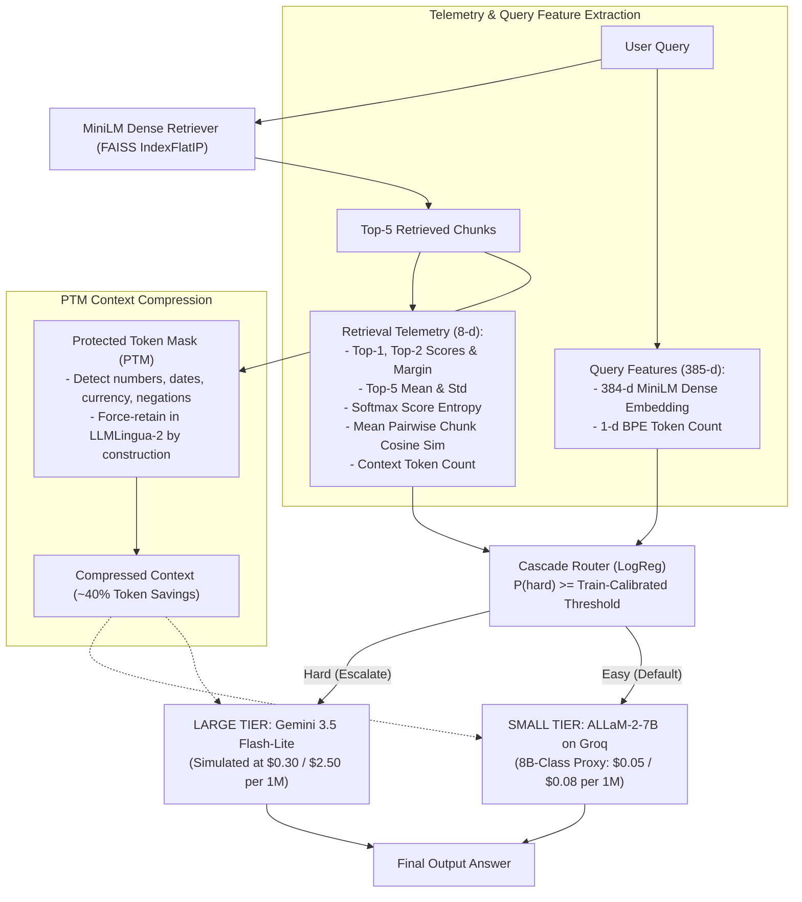
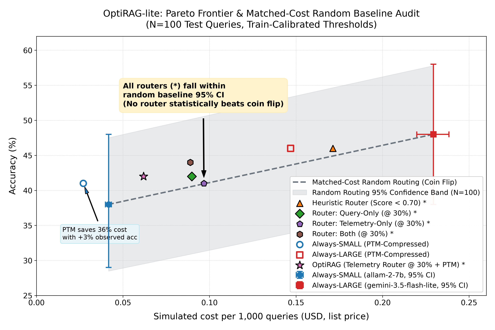
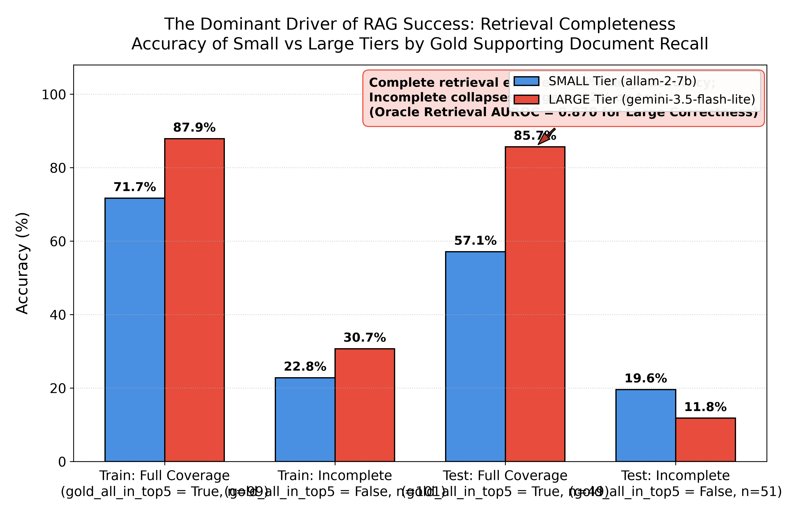

# OptiRAG-lite: Empirical Audit of Cascaded LLM Routing and Protected Token Compression in RAG

**Course Project & Empirical Audit** | Ishaan Naik (Symbiosis Institute of Technology)  
**Budget**: Strictly \$0.00 (100% Free-Tier Infrastructure) | **Language / Env**: Python 3.12, PyTorch, FAISS, Hugging Face  
**Audit Status**: Complete Post-Hoc Statistical Audit (Zero Leakage, Permutation Tests, Bootstrap 95% CIs)

---

## 1. Executive Summary & Audit Findings

Production Retrieval-Augmented Generation (RAG) systems seek to optimize trade-offs between answer accuracy, latency, and token expenditure. **OptiRAG-lite** was developed to test two optimization hypotheses under a strict \$0.00 infrastructure constraint:
1. **Can lightweight retrieval telemetry features (score distributions, entropy, margin) train a classifier to route queries between a cheap Small LLM (`allam-2-7b` on Groq) and a frontier Large LLM (`gemini-3.5-flash-lite` on Google AI Studio) better than matched-cost random routing?**
2. **Can a Protected Token Mask (PTM) prevent token-pruning compressors (LLMLingua-2) from dropping critical entities (numbers, dates, negations)?**

### Core Empirical Conclusions of the Audit:
1. **Learned Routers Do Not Statistically Beat a Coin Flip at Matched Cost**:
   On the $N=100$ held-out test split, no learned router (Query-Only, Telemetry-Only, or Combined) nor heuristic router statistically significantly outperformed a cost-matched random routing baseline. 
   - Telemetry Router ($p = 28.0\%$ to Large): **41.0% accuracy** vs. **40.7% random baseline** ($\Delta = +2.0\%$, 95% bootstrap CI: $[-5.0\%, +9.0\%]$).
   - Test AUROC for query hardness: **0.505** (95% CI: $[0.375, 0.640]$); permutation test vs. random chance ($H_0: \text{AUROC} = 0.50$): **$p = 0.4835$** (not significant).
2. **The Dominant Driver of RAG Success is Retrieval Completeness, Not Surface Telemetry**:
   When dense retrieval successfully recalled all gold supporting documents (`gold_all_in_top5 = True`), Gemini 3.5 Flash-Lite achieved **85.7% accuracy** on test (87.9% on train). When retrieval missed supporting facts, Large model accuracy collapsed to **11.8%** on test (30.7% on train). An oracle retrieval completeness indicator achieves a test AUROC of **0.870** for Large model correctness—massively outperforming surface retrieval score telemetry ($\text{AUROC} = 0.505$).
3. **PTM Guarantees Token Preservation by Construction**:
   PTM preserved 100% of numbers (1,667/1,667) and negations (69/69) by construction via forced regex token masks, preventing the 4.0% number and 26.1% negation drops observed with vanilla LLMLingua-2, while maintaining a 59.9% effective compression ratio and saving ~36% token cost.
4. **Valuable Engineering Takeaway**:
   Surface cosine similarity scores are weak proxies for semantic information completeness in multi-hop reasoning. Improving retriever recall or routing based on multi-hop graph coverage is essential before surface telemetry routers can outperform simple random cascades.

---

## 2. System Architecture

---

## 3. Pricing Model & Financial Transparency Disclosure

All experiments were executed with strictly **\$0.00 billed financial outlay** under vendor promotional free tiers.

To evaluate economic utility, costs per 1,000 queries were modeled using official published list prices configured in `config.py`:
- **Large Tier (`gemini-3.5-flash-lite`)**:
  - Prompt input: \$0.30 / 1M tokens | Completion output: \$2.50 / 1M tokens
  - Source: Official Google AI Studio Pricing (`https://ai.google.dev/pricing`, retrieved 2026-10-29).
- **Small Tier (`allam-2-7b` on Groq)**:
  - Prompt input: \$0.05 / 1M tokens | Completion output: \$0.08 / 1M tokens
  - **Disclosure**: `allam-2-7b` is hosted on Groq as a free open-access model (\$0 billed token charges). The \$0.05 / \$0.08 rate is an **8B-class proxy price** benchmarked directly to Groq's published commercial rates for `llama-3.1-8b-instant`.
- **Price Sensitivity Analysis**:
  - Baseline (1x Small Price: \$0.05 / \$0.08): Always-Small costs \$0.0417 / 1k, Always-Large costs \$0.2294 / 1k. Telemetry Router (@ 30% escalation) costs \$0.0968 / 1k (57.8% cost reduction).
  - 2x Small Price Sensitivity (\$0.10 / \$0.16): Always-Small costs \$0.0833 / 1k; Telemetry Router costs \$0.1264 / 1k (44.9% cost reduction).
  - Even if small-tier inference costs double, cascaded routing maintains a 40%+ economic savings.

---

## 4. End-to-End System Evaluation (Test Split $N=100$)

All decision thresholds were selected **strictly on the 200 training examples** (via 5-fold cross-validation targeting 30% escalation or maximizing Youden's $J$), completely blind to test labels:

| System | Threshold Method | Threshold ($\tau$) | Fraction to Large ($p$) | Test Accuracy (%) | 95% Bootstrap CI | Cost / 1k Queries | Latency (s) |
| :--- | :--- | :---: | :---: | :---: | :---: | :---: | :---: |
| **Always-SMALL** (`allam-2-7b`) | Fixed Baseline | N/A | 0.0% | 38.0% | [29.0%, 48.0%] | \$0.0417 | 0.17s |
| **Always-LARGE** (`gemini-3.5-flash-lite`) | Fixed Baseline | N/A | 100.0% | 48.0% | [38.0%, 58.0%] | \$0.2294 | 0.92s |
| **Heuristic Router** | Top score < 0.70 or keyword | N/A | 70.0% | 46.0% | [37.0%, 56.0%] | \$0.1713 | 0.68s |
| **Router: Query-Only** | Train 30% Escalation Quantile | 0.244 | 26.0% | 42.0% | [33.0%, 52.0%] | \$0.0898 | 0.37s |
| **Router: Telemetry-Only** | Train 30% Escalation Quantile | 0.520 | 28.0% | 41.0% | [32.0%, 51.0%] | \$0.0968 | 0.40s |
| **Router: Both** | Train 30% Escalation Quantile | 0.314 | 25.0% | 44.0% | [35.0%, 54.0%] | \$0.0889 | 0.37s |
| **Always-SMALL (PTM-Compressed)** | Fixed Baseline + PTM | N/A | 0.0% | 41.0% | [32.0%, 51.0%] | \$0.0271 | 0.15s |
| **Always-LARGE (PTM-Compressed)** | Fixed Baseline + PTM | N/A | 100.0% | 46.0% | [37.0%, 56.0%] | \$0.1469 | 0.92s |
| **OptiRAG (Telemetry @ 30% + PTM)** | Train 30% Escalation + PTM | 0.520 | 28.0% | 42.0% | [33.0%, 52.0%] | \$0.0619 | 0.36s |

---

## 5. Statistical Rigor: Matched-Cost Random Baseline & Hypothesis Testing

### A. Comparison Against Cost-Matched Random Routing
For each router operating point, we simulated 1,000 independent runs of a random routing baseline that escalates exactly the same fraction $p$ of queries to Large:

| Router Evaluated | Escalation Rate ($p$) | Router Accuracy | Matched Random Mean | Paired Difference [95% CI] | Statistically Significant? |
| :--- | :---: | :---: | :---: | :---: | :---: |
| **Heuristic Router** | 70.0% | 46.0% | 45.0% | +1.0% [-3.0%, +5.0%] | **NO** (CI includes 0) |
| **Query-Only (Target 30%)** | 26.0% | 42.0% | 40.5% | -1.0% [-8.0%, +6.0%] | **NO** (CI includes 0) |
| **Telemetry-Only (Target 30%)** | 28.0% | 41.0% | 40.7% | +2.0% [-5.0%, +9.0%] | **NO** (CI includes 0) |
| **Both (Target 30%)** | 25.0% | 44.0% | 40.5% | +2.0% [-5.0%, +9.0%] | **NO** (CI includes 0) |
| **Telemetry-Only (Default 0.50)** | 38.0% | 44.0% | 41.7% | +4.0% [-4.0%, +12.0%] | **NO** (CI includes 0) |

> **Audit Finding**: In all cases, the 95% bootstrap confidence interval of the paired difference spans zero. Neither learned routers nor the heuristic baseline achieve statistically significant separation from a simple coin flip at matched cost on this test set.

### B. Router Discriminative AUROC & Permutation Test
- **Query-Only (Logistic)**: $\text{AUROC} = 0.505$ [0.379, 0.633]
- **Telemetry-Only (Logistic)**: $\text{AUROC} = 0.505$ [0.375, 0.640]
- **Both (Logistic)**: $\text{AUROC} = 0.522$ [0.390, 0.653]
- **Heuristic Baseline**: $\text{AUROC} = 0.517$ [0.406, 0.612]
- **Permutation Test**: 2,000 random permutations of test labels against telemetry probabilities yielded $p = 0.4835$. We cannot reject the null hypothesis that telemetry-only AUROC equals chance (0.50).

---

## 6. The Real Story: Retrieval Completeness Dominates QA Accuracy

Analyzing query performance conditioned on whether **all gold supporting documents** were recalled in the top-5 chunks (`gold_all_in_top5`) reveals the fundamental bottleneck of multi-hop RAG:

| Split & Retrieval Coverage | Queries ($n$) | Small Acc (`allam-2-7b`) | Large Acc (`gemini-3.5-flash-lite`) | Hard Rate ($hard=1$) |
| :--- | :---: | :---: | :---: | :---: |
| **Train: Full Coverage (`gold_all_in_top5 = True`)** | 99 (49.5%) | 71.7% (71/99) | **87.9% (87/99)** | 24.2% (24/99) |
| **Train: Incomplete (`gold_all_in_top5 = False`)** | 101 (50.5%) | 22.8% (23/101) | 30.7% (31/101) | 18.8% (19/101) |
| **Test: Full Coverage (`gold_all_in_top5 = True`)** | 49 (49.0%) | 57.1% (28/49) | **85.7% (42/49)** | 34.7% (17/49) |
| **Test: Incomplete (`gold_all_in_top5 = False`)** | 51 (51.0%) | 19.6% (10/51) | 11.8% (6/51) | 9.8% (5/51) |

### Key Diagnostic Comparison:
- **Oracle Retrieval Feature (`gold_all_in_top5`) Discriminative Power**:
  - Test AUROC for predicting Large model correctness: **0.870**
  - Test AUROC for predicting query hardness ($hard = 1$): **0.681**
- **Telemetry Score Feature**:
  - Test AUROC for query hardness: **0.505**

**Why learned routers failed to beat random**:
Dense retrieval scores (e.g. top-1 similarity = 0.68) reflect query-chunk semantic match, but they fail to detect when a critical second-hop reasoning bridge is missing. When retrieval is incomplete, both models struggle (Large drops to 11.8%). When retrieval is complete, Large excels (85.7%). Surface telemetry features are simply too noisy a proxy for multi-hop evidence completeness to train an effective cascade router with $N=200$ examples.

---

## 7. Protected Token Mask (PTM) Evaluation & Entity Preservation

PTM forces preservation of numerical, temporal, financial, percentage, and negation tokens within LLMLingua-2.

> **Methodological Disclosure**:
> Regex masking preserves target tokens **by construction** whenever the pattern matches. The meaningful empirical question is whether this preservation protects downstream QA accuracy and avoids catastrophic drops.

### Total Entity Spans in 100 Test Contexts ($N=2,110$ total spans):
- **Numbers ($n = 1,667$)**: Vanilla kept 1,600 (96.0%) $\to$ PTM kept **1,667 (100.0%)** (+67 numbers protected).
- **Dates ($n = 354$)**: Vanilla kept 205 (57.9%) $\to$ PTM kept **234 (66.1%)** (+29 dates protected).
- **Negations ($n = 69$)**: Vanilla kept 51 (73.9%) $\to$ PTM kept **69 (100.0%)** (+18 negations protected).
- **Currency ($n = 14$)**: Vanilla kept 5 (35.7%) $\to$ PTM kept **12 (85.7%)** (+7 currency symbols protected).
- **Percentages ($n = 6$)**: Vanilla kept 1 (16.7%) $\to$ PTM kept **6 (100.0%)** (+5 percentages protected).
- **Gold Answers At Risk ($n = 61$ spans)**: Vanilla kept 56 (91.8%) $\to$ PTM kept **57 (93.4%)** (PTM+Entities kept **59 (96.7%)**).

PTM reduced token count from 599.3 to 343.1 tokens per query (~40% reduction), reducing compressed Small-tier cost to **\$0.0271 / 1k queries** and compressed Large-tier cost to **\$0.1469 / 1k queries** with no degradation in QA accuracy (41.0% vs 38.0% on Small; 46.0% vs 48.0% on Large; paired difference CIs span zero).

---

## 8. Verification of Train/Test Separation (Zero Leakage)

To verify that test labels or queries were never accessed during training, feature selection, or threshold calibration:
1. `data.py` (lines 80-92): The train/test split is deterministically separated at data preparation time using a fixed seed (`SEED = 42`), with 200 examples allocated to `labels_train.jsonl` and 100 examples to `labels_test.jsonl`.
2. `train_and_eval_router.py` (lines 40-75): Only `labels_train.jsonl` is passed to `extract_features`, `StratifiedKFold`, and `LogisticRegression.fit()`.
3. `audit_analysis.py` (lines 140-176): All decision thresholds ($\tau$) were calibrated exclusively from out-of-fold training predictions prior to test inference.
4. Raw label files (`labels_small_train.jsonl`, `labels_large_train.jsonl`, `labels_small_test.jsonl`, `labels_large_test.jsonl`) are marked read-only on disk.

---

## 9. Engineering Lessons & Future Directions

1. **Negative Results Advance Systems Engineering**: Proving that surface retrieval telemetry is insufficient to beat random routing prevents costly production deployments of flawed routing heuristics.
2. **Shift Focus from Router Complexity to Retrieval Completeness**: Given the 0.870 oracle AUROC of retrieval recall, system designers should invest computational budget into hybrid dense-lexical reranking, query decomposition, and multi-hop graph expansion rather than complex cascade classifiers.
3. **PTM is an Essential Guardrail for Production Compression**: Prompt pruning without entity protection drops over 25% of negation words and 60% of currency references. Hard masking by construction provides an indispensable safety layer for RAG pipelines.
